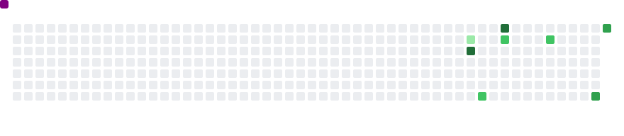

<!-- reading-log:start -->

**What I'm reading** — LLM / ML-systems efficiency papers, each read in full text. **29** read · **12** notes · **10** active days · **4**-day streak · latest: [SOAR](https://arxiv.org/abs/2611.27639) · [Restoring Diversity in Distilled Image…](https://arxiv.org/abs/2611.18550) · [Evolving Infra](https://arxiv.org/abs/2611.12304) · [full log →](READING-LOG.md)

<picture><source media="(prefers-color-scheme: dark)" srcset="https://raw.githubusercontent.com/SubSir/SubSir/main/reading-snake-dark.svg?v=4b3c1375"></picture>

**Code** — GitHub contributions

<picture><source media="(prefers-color-scheme: dark)" srcset="https://raw.githubusercontent.com/SubSir/SubSir/output/github-snake-dark.svg"></picture>

<!-- reading-log:end -->
