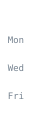
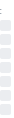
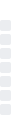
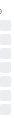
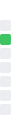
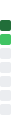
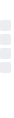

<!-- reading-log:start -->

**What I'm reading** — LLM / ML-systems efficiency papers, each read in full text. **25** read · **9** notes · **8** active days · **2**-day streak · latest: [QServe](https://proceedings.mlsys.org/paper_files/paper/2025/hash/fbe2b2f74a2ece8070d8fb073717bda6-Abstract-Conference.html) · [FlashAttention](https://arxiv.org/abs/2205.14135) · [SMELT](https://arxiv.org/abs/2609.01343) · [full log →](READING-LOG.md)

<!-- reading-log:end -->

<picture>
  <source media="(prefers-color-scheme: dark)" srcset="https://raw.githubusercontent.com/SubSir/SubSir/output/github-snake-dark.svg">
  
</picture>
